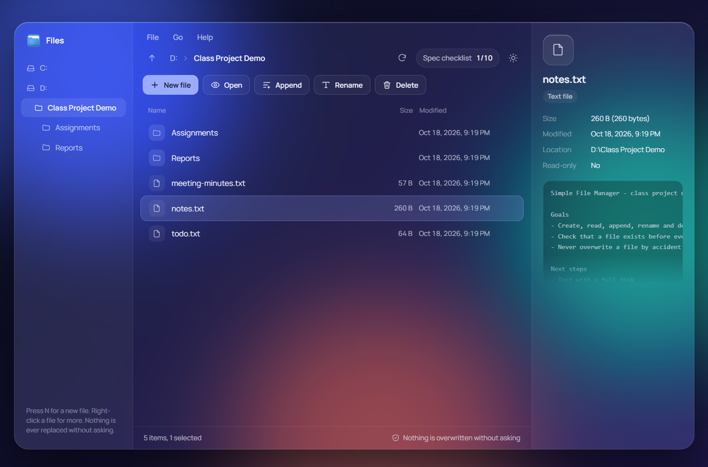
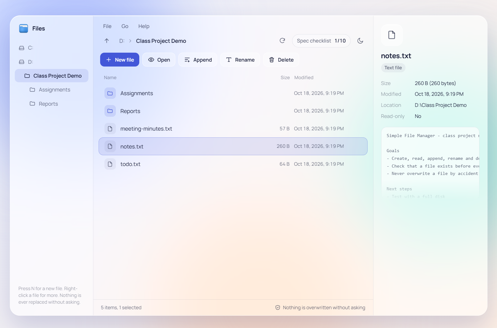
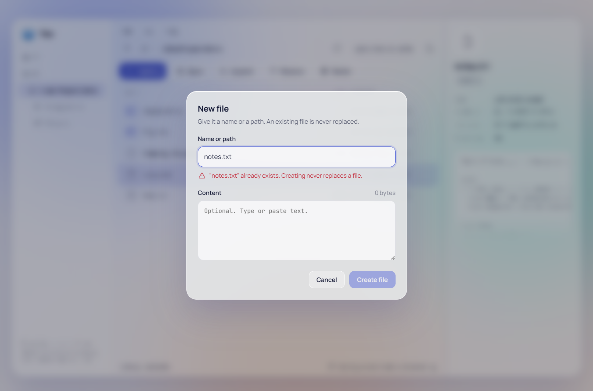

<p align="center">
  
</p>

<h1 align="center">Simple File Manager</h1>

<p align="center">
  A safe, menu-driven file manager for Windows with a glass-style interface.<br>
  <em>Built as a class project.</em>
</p>

<p align="center">
  
  
  
  
</p>

<p align="center">
  
</p>

## About

**Simple File Manager** is a desktop file manager for Windows, built as a class project. You can create, view, append to, rename and delete text files, and switch between drives, all from a menu bar, toolbar, right-click menu or keyboard shortcuts.

The project focuses on safe file handling. Every operation checks that the file exists and that the name is valid, and handles errors. The app never overwrites a file without asking. If a write fails part-way, for example on a full disk, the file goes back to how it was.

## Features

- **Five file operations:** create, read, append to, rename and delete text files
- **Menu-driven:** File / Go / Help menus, a toolbar, a right-click menu and keyboard shortcuts
- **Never overwrites by accident:** names are checked as you type, and an existing file is never replaced
- **Clear error messages** that say what failed and why, for example *read-only*, *already exists* or *disk full*
- **Drive picker:** every ready drive on your computer, with its free space
- **File viewer** with line numbers, plus a quick preview of the selected file
- **Works with Windows Snap Layouts:** the layout adapts to half, third, quarter and full-screen windows, down to 400×340
- **Light and dark themes** that follow Windows, with a toggle
- **Accessible:** usable by keyboard alone, and respects Windows' reduce-motion and transparency settings

<table>
  <tr>
    <td></td>
    <td></td>
  </tr>
  <tr>
    <td align="center">Light theme</td>
    <td align="center">Creating a file never replaces an existing one</td>
  </tr>
</table>

## Download

1. Go to **[Releases](../../releases)** and download `Simple-File-Manager-Setup-<version>.exe`.
2. Run it. Windows may show **"Windows protected your PC"** because the app is not code-signed. Click **More info**, then **Run anyway**.
3. Choose a folder, or keep the default (no administrator rights needed). The installer adds a desktop shortcut and a Start menu entry.

To uninstall: **Settings → Apps → Installed apps → Simple File Manager → Uninstall**.

## How to use it

Every action is in the **File** menu, the toolbar and the right-click menu, and has a keyboard shortcut:

| Key | Action |
|---|---|
| `N` | New file |
| `Enter` / double-click | Open a folder, or view a file |
| `A` | Append to the selected file |
| `F2` | Rename the selected file |
| `Delete` | Delete the selected file (asks first; **Cancel** is the default) |
| `I` | File information |
| `Backspace` | Up one folder |
| `F5` | Refresh |
| `Alt+F` / `Alt+G` / `Alt+H`, `F10` | Open a menu, then use the arrow keys; `Esc` closes it |
| `Ctrl+Enter` | Save from a text box (New, Append) |
| `Esc` | Close a menu, dialog or panel |

**Switching drives:** click a drive in the sidebar, or use **Go → Drives**. Hover over a drive to see its free space. A USB stick plugged in while the app is open appears after `F5`.<br>
**Other folders:** **Go → Open folder…** opens a folder picker, and the Go menu also lists your 5 most recent folders.

## How it keeps your files safe

| Operation | Protection |
|---|---|
| **Create** | Fails instead of replacing a file that already exists. **Create** stays disabled while the name is taken or invalid. |
| **Read** | Shows up to 1 MiB of text; a larger file shows a notice. Binary files are detected and are not shown as text. |
| **Append** | Never re-creates a file that has disappeared. If the write fails part-way, the file goes back to its old content. |
| **Rename** | Refuses when the new name is already taken. Changing only capital letters (`notes.txt` → `Notes.txt`) is allowed. |
| **Delete** | Asks first, showing the name, size and date, with **Cancel** selected. Read-only files and folders are refused. |
| **Names** | Rejects characters Windows doesn't allow (`< > : " \| ? *`), reserved names (`CON`, `NUL`, `COM1`…) and paths that are too long, each with its own message. |

<details>
<summary><b>Technical details</b></summary>

<br>

| Operation | How it is done |
|---|---|
| **Create** | Opened with `O_WRONLY \| O_CREAT \| O_EXCL`, so creating either succeeds or fails in one step and can never overwrite. If writing fails, the half-written file is removed. |
| **Read** | Reads at most 1 MiB. A zero byte in the first 512 bytes marks the file as binary. `\r` is removed for display. |
| **Append** | Opened with `O_RDWR \| O_APPEND` and **without** `O_CREAT`. A newline is added first if the file lacks one. If a write fails, the file is truncated back to its old size. |
| **Rename** | Explicit exists-check (by device and inode), because Node's `rename` would silently replace the target. |
| **Delete** | The read-only check runs **before** `unlink`, because on Windows `unlink` would clear the read-only flag and delete the file anyway. A link to a folder is never followed. |
| **Line endings** | Text is written with CRLF, so files open correctly in Notepad. |

Every `open`, `read`, `write`, `fsync`, `close`, `rename` and `unlink` call is checked. Each descriptor is closed in a `finally` block, and the close itself is checked. Writes loop until every byte is written. System error codes are translated in one place (`statusFromErrno`).

**Security:** the window's page is sandboxed (`contextIsolation`, `sandbox`, no `nodeIntegration`, a strict Content-Security-Policy, and blocked navigation and pop-ups). It reaches files only through a small preload API. ESLint and a test check that it never imports `fs`, `path` or `electron`.

</details>

## Build from source

You need [Node.js](https://nodejs.org/) 20 or newer.

```bash
npm install        # install the dependencies
npm start          # run the app (npm start -- "D:\some\folder" opens that folder)
npm test           # 24 unit tests (node:test)
npm run lint       # ESLint, zero warnings allowed
npm run dist       # build the installer into dist\
```

`npm run dist` creates `dist\Simple-File-Manager-Setup-<version>.exe` (about 115 MB), which is the file to attach to a GitHub Release. Only `package.json` and `src/` are packed into the app.

<details>
<summary><b>Maintainer notes</b></summary>

<br>

- **New release:** raise `"version"` in `package.json`, run `npm run dist`, then create a release with a tag such as `v2.0.0` and attach the Setup `.exe`. Don't commit the `.exe`: GitHub rejects files over 100 MB in a repository.
- **App icon:** the source image is `icon/file manager icon.jpg`. `powershell -File scripts\make-icon.ps1` makes its white background transparent and writes `icon/app.ico` (the exe icon) and `src/renderer/icon.png` (the window icon and sidebar logo).
- **VS Code terminals** set `ELECTRON_RUN_AS_NODE`, which stops Electron from opening a window. `npm start` clears it. If you start a built `.exe` from such a terminal, clear the variable first.
- **One copy at a time:** starting the app again brings the open window to the front.

</details>

## Project structure

```
src/main/       window, IPC and all file logic (file_ops, validate, fs_scan) - no UI code
src/preload/    the small, safe API the window is allowed to use (window.fm)
src/shared/     every user-visible message, plus size and date formatting
src/renderer/   the interface: index.html, app.js (state and actions), ui/ (drawing), styles/
tests/          unit tests using real temporary folders, including simulated disk-full errors
docs/           design decisions, test plan and screenshots
scripts/        start launcher and icon builder
```

## Known limitations

- Folders can't be created or deleted, and there's no copy, multi-select, drag-and-drop or Recycle Bin.
- Hidden files are recognised by name (`.`/`$` prefixes, `desktop.ini`, `Thumbs.db` and so on), because Node can't read Windows' hidden attribute.
- The sidebar shows the path to the current folder and its subfolders, not the whole drive.
- A network drive that takes more than 1.5 s to respond is left out of the drive list. It can still be opened with **Go → Open folder…**.
- The app doesn't watch the disk: changes made by other programs appear after `F5` or the next operation.
- There's a very short gap between the "does the target exist?" check and the rename itself.

## Class project notes

The design follows `PROJECT_STRUCTURE.md`, and the interface is a port of the mockup `UI_MOCKUP_GLASS.html`. The mockup's simulated disk was replaced by real file operations. Choices and deviations are listed in [docs/DECISIONS.md](docs/DECISIONS.md), and test results are in [docs/TEST_PLAN.md](docs/TEST_PLAN.md). An earlier text-console version, written in C with PDCurses, is a separate project.

<details>
<summary><b>Requirements checklist</b></summary>

<br>

| Requirement | Where |
|---|---|
| Menu for file operations | `src/renderer/ui/menubar.js` (File/Go/Help), `ui/toolbar.js`, `ui/contextmenu.js`; all dispatch to `app.js` `actNew` / `actOpen` / `actAppend` / `actRename` / `actDelete` / `actProps` / `actRefresh` / `actExit` |
| Accept a file name | `ui/sheets.js` `sheetNew` / `sheetRename` + `app.js` `checkTarget` (live hints) → `src/main/validate.js` `fm_validate_path`, `fm_resolve_input` |
| Accept file content | `ui/sheets.js` `sheetNew` / `sheetAppend` text areas with live byte counts |
| Open and close files correctly | `src/main/file_ops.js`: every `openSync` is followed by a `finally` that calls `closeChecked`; writes go through `writeAll` and then `fsyncSync` |
| Check errors during file operations | `file_ops.js` try/catch around every call → `status.js` `statusFromErrno` → `src/shared/messages.js` `formatError` |
| Prevent accidental overwriting | `fm_create` (`O_EXCL`), `fm_append` (no `O_CREAT`), `fm_rename` (dev/ino exists-check), `fm_delete` (read-only check) + `app.js` `actDelete` confirmation (Cancel default) + live "already exists" hints |
| Input: names and paths | `validate.js` `fm_resolve_input` (relative names resolve against the folder shown) |
| Input: commands | `app.js` keydown / click / contextmenu handlers, menus, toolbar |
| Output: file content on screen | `ui/sheets.js` `sheetViewer` (line numbers, size and line-count chips, truncation banner); `ui/details.js` 10-line preview |
| Output: status and errors | `ui/toasts.js` `toast` (`role="status"` / `role="alert"`), sheet hint lines (`setHint`), `renderBar` |
| Output: name, size and more | `ui/details.js` `renderDetails` / `factsHtml`, `sheetInfo`, list Size and Modified columns |
| Existence checks | `file_ops.js` `fm_exists` / `fm_get_info`; `app.js` `preCheck` before Append / Rename / Delete; stale-file handling in `fail` (refresh, never re-create) |
| Menu-based navigation | Go menu (Up, Open folder…, Drives, Recent folders), `ui/sidebar.js` tree with every ready drive (`src/main/fs_scan.js` `fs_drives`), `ui/breadcrumbs.js` crumbs + Up |
| Tests | `npm test`: 24 tests covering section 12.1, plus injected disk-full, short-write, failed-close and failed-fsync errors. Manual script results are in `docs/TEST_PLAN.md` |

</details>

## Credits

- Built with [Electron](https://www.electronjs.org/)
- Fonts: [Manrope](https://fonts.google.com/specimen/Manrope) and [JetBrains Mono](https://www.jetbrains.com/lp/mono/), both under the SIL Open Font License (the license files are in `src/renderer/fonts/`)
